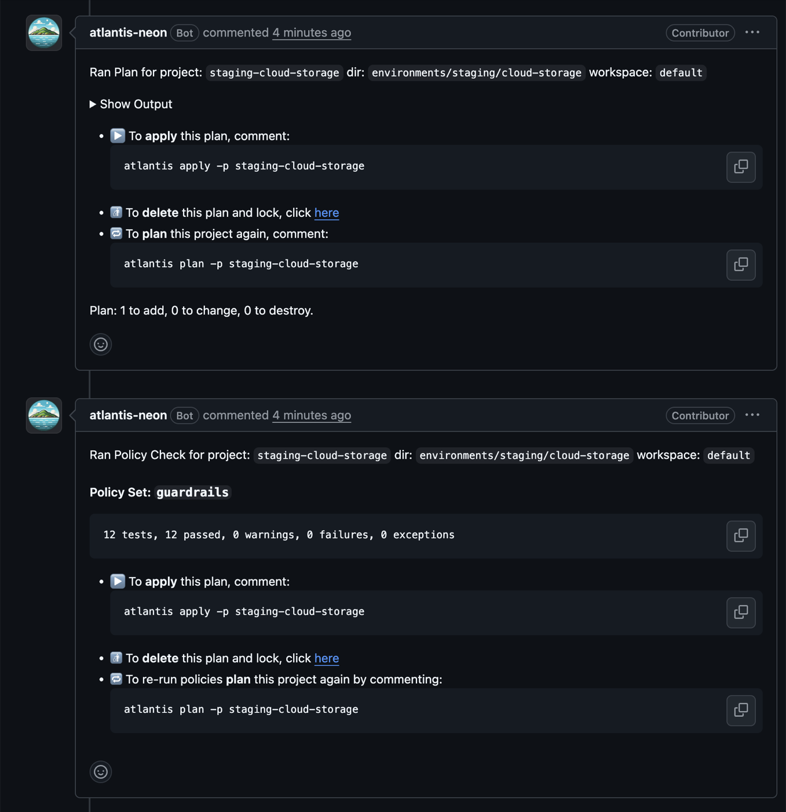
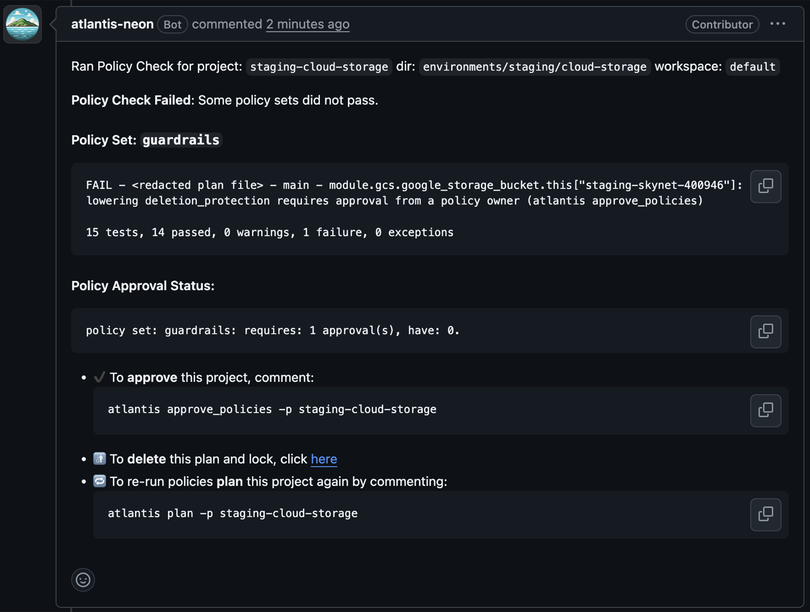
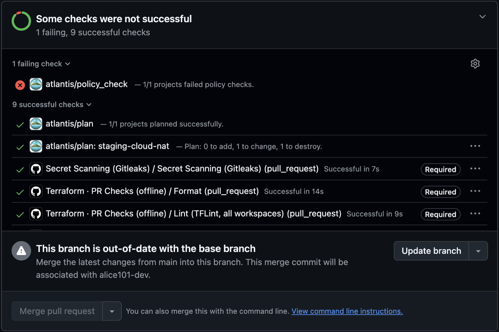
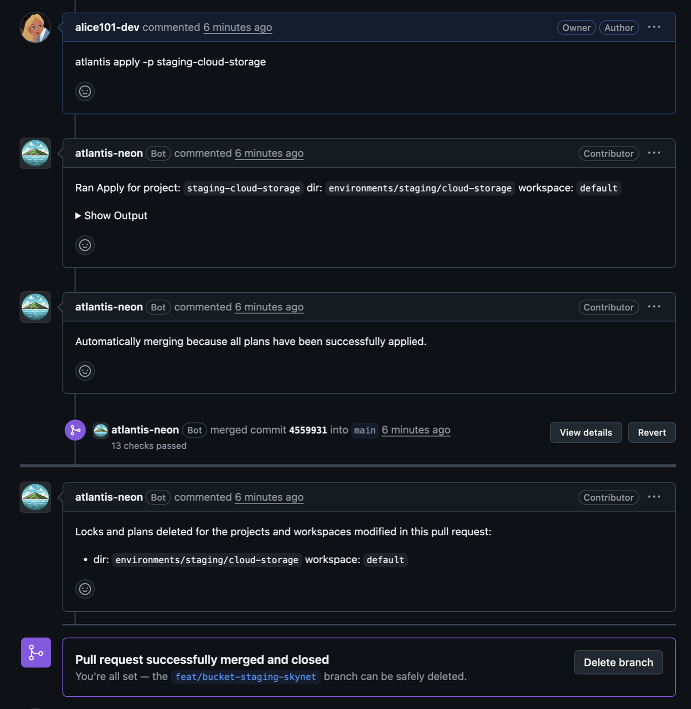

# Hardened Atlantis on GKE — GitOps Terraform for GCP

[](https://github.com/alice101-dev/terraform-atlantis/actions/workflows/pr-checks.yml)

Terraform for GCP, planned and applied from pull requests by a **hardened Atlantis** running on GKE: deployed with Argo CD, reachable only through Cloudflare, guarded by policy checks, and running with least-privilege GCP access. See *🔐 Security*.

Small, reusable modules + decoupled per-service workspaces (each with its own state) to keep the blast radius low. Workspaces find each other **by name** (`data` sources), not `terraform_remote_state`.

## 📂 Layout

```text
bootstrap/staging/             # Layer 0: GCS state bucket (human)
environments/staging/          # in apply order
├── services/                  # GCP APIs + service agents
├── kms/                       # KeyRing + one CMEK key per consumer
├── secret-manager/            # Secret containers + per-secret IAM
├── service-accounts/          # Service account identities (human)
├── iam/                       # Project role bindings (human)
├── vpc/                       # VPC + subnets
├── cloud-nat/                 # Cloud Router + Cloud NAT
├── firewall/                  # Firewall rules
├── static-ip/                 # Public IP for the kgateway LoadBalancer
├── kubernetes-engine/         # GKE cluster + node pools (human)
├── atlantis-identity/         # Atlantis GSA + Workload Identity (human)
├── argocd-bootstrap/          # Argo CD + root Application (human)
├── cloud-storage/             # General GCS buckets
├── artifact-registry/         # Docker repositories
├── cloud-sql-postgres-app/    # Cloud SQL PostgreSQL
└── backup-for-gke/            # Backup for GKE plan
modules/<name>/                # Reusable modules, each with tests/
gitops/
├── root.yaml                  # Root Application
├── appsets/                   # AppProject, Gateway API CRDs, ApplicationSets
├── controllers/<name>/        # Upstream Helm chart: config.yaml + values.yaml
├── configs/<name>/            # Local Helm chart: config.yaml + templates
└── atlantis/                  # Atlantis values + config chart (secrets, route, policies)
```

`(human)` = applied by a human; every other workspace is applied through Atlantis (`atlantis.yaml`).

A component runs only on clusters labelled `enable_<name>=true` (`enabled_components` in `argocd-bootstrap`). Config charts receive per-env values that stay out of Git — hostname, project, cluster, IP name — as `.Values.platform.*`, read from the in-cluster cluster secret annotations `platform/*`.

Each workspace: `backend.tf`, `provider.tf`, `variables.tf`, `main.tf` (thin wrapper), `outputs.tf`, `.terraform.lock.hcl`, `<env>.tfvars`.

| | |
|---|---|
| **Region / Zone** | `asia-southeast2` / `asia-southeast2-a` |
| **Terraform** | `~> 1.17.0` (`.terraform-version` = `1.17.2`, via `tfenv`) |
| **Provider** | `hashicorp/google ~> 8.12.0` |
| **Project** | one GCP project per env — `TF_VAR_project_id` (never committed) |
| **State** | GCS bucket from `bootstrap/<env>/`, `prefix = "<env>/<service>"` |
| **Environments** | `staging` only; prod = clone of staging (`workspace-management` skill) |

## 🔗 Apply order

A workspace only works once its dependencies exist in GCP:

| Workspace | Depends on | Note |
|---|---|---|
| `services` | — | Apply first |
| `service-accounts` | `services` | Before `iam` |
| `iam` | `service-accounts`, `secret-manager` | SA + secret `iam-memberships` must exist |
| `kms` | `services` | Before every CMEK consumer |
| `secret-manager` | `services`, `kms` | Key `secret-manager`; add secret values before `iam` / `kubernetes-engine` |
| `atlantis-identity` | `services`, `bootstrap`, `kubernetes-engine` | Human-only: Atlantis never changes its own permissions. The Workload Identity binding needs the cluster's identity pool |
| `vpc` | `services` | Network + PSA |
| `cloud-nat`, `firewall` | `vpc` | |
| `static-ip` | `services` | Origin IP for the Cloudflare DNS record |
| `kubernetes-engine` | `vpc`, `kms`, `secret-manager` | Key `gke`, secret `gke-admin-networks` |
| `cloud-sql-postgres-app` | `vpc`, `kms` | Key `cloud-sql` — **CMEK is create-time only** |
| `cloud-storage` | `kms`, `atlantis-identity` | Key `storage`; full bucket names in tfvars |
| `artifact-registry` | `services`, `kms` | Key `artifact-registry` |
| `argocd-bootstrap` | `kubernetes-engine`, `secret-manager` (`atlantis-hostname` value), `atlantis-identity`, `static-ip` | Human-only; Argo CD UI via `kubectl port-forward` (see `terraform output argocd_ui`) |
| `backup-for-gke` | `kubernetes-engine`, `kms` | `enable_gke_backup_agent = true`, key `backup-gke` |

## 🛠 Setup (one-time)

```bash
# Terraform via tfenv (reads .terraform-version)
brew install tfenv && tfenv install && tfenv use

# Checkov — same version as CI
brew install pipx && pipx ensurepath && pipx install checkov==3.3.7

# GCP auth + project (the project ID is never committed — Terraform reads TF_VAR_project_id)
gcloud auth login && gcloud auth application-default login
gcloud config set project <your-gcp-project-id>
export TF_VAR_project_id="$(gcloud config get-value project)"
```

Service agents needed by the CMEK bindings in `kms` are created by the `services` workspace (`service_identities`, `google-beta` provider).

State bucket: create it with `bootstrap/<env>/` — steps in `bootstrap/staging/README.md`.

### Private inputs (Secret Manager)

Personal data and credentials stay out of Git. The `secret-manager` workspace creates the containers (CMEK, per-secret IAM); a human adds the values:

| Secret | Read by | Value |
|---|---|---|
| `staging-iam-memberships` | `iam` | `{"you@example.com": ["engineer"]}` |
| `staging-gke-admin-networks` | `kubernetes-engine` | `[{"cidr_block": "203.0.113.10/32", "display_name": "admin"}]` |
| `staging-atlantis-hostname` | `argocd-bootstrap` | public hostname of Atlantis |
| `staging-cloudflare-api-token` | cert-manager (KSA `cert-manager/cert-manager-secrets`) | Cloudflare API token: `Zone:DNS:Edit` + `Zone:Zone:Read`, scoped to the one zone |
| `staging-atlantis-gh-app-id`, `staging-atlantis-gh-app-slug` | `argocd-bootstrap` | GitHub App ID and slug |
| `staging-atlantis-gh-app-key`, `staging-atlantis-gh-webhook-secret` | Atlantis (KSA `atlantis/atlantis-secrets`) | GitHub App private key (PEM), webhook secret |

```bash
printf '%s' '{"you@example.com":["engineer"]}' | gcloud secrets versions add staging-iam-memberships --data-file=-
printf '%s' '[{"cidr_block":"203.0.113.10/32","display_name":"admin"}]' | gcloud secrets versions add staging-gke-admin-networks --data-file=-
gcloud secrets versions add staging-atlantis-gh-app-key --data-file=app-private-key.pem   # then delete the local file
```

## 💻 Daily workflow

```bash
cd environments/staging/<service>
terraform init && terraform validate
terraform plan -var-file="staging.tfvars" -out=tfplan   # local preview only

# Module tests + security scan (CI runs these too, plus fmt, TFLint, conftest, Gitleaks)
terraform -chdir=modules/<name> init -backend=false && terraform -chdir=modules/<name> test
checkov -d . --config-file .checkov.yaml --compact
```

Collections are maps (`for_each`) — add/remove infra = add/remove a map key in `.tfvars`. No secrets in `.tfvars`; use Secret Manager or IAM auth.

Applying: workspaces in `atlantis.yaml` are applied **only through a PR** (see *Atlantis*); `(human)` workspaces are applied from an up-to-date `main` with `terraform apply tfplan`.

### Repository settings

`main` is protected by `.github/branch-protection.json`: PR required (admins included), branch must be up to date, no force push or deletion, and every CI job must pass — Detect Terraform changes, Format, Validate, Unit tests, Checkov, TFLint, Policy tests, Gitleaks. On a PR that touches no Terraform files the Terraform jobs are skipped, which counts as passing. Apply after editing the file:

```bash
gh api -X PUT repos/alice101-dev/terraform-atlantis/branches/main/protection --input .github/branch-protection.json
```

The file is tuned for a single maintainer with Atlantis not always running. With `enforce_admins: true` nobody can approve their own PR, so a required approval would block every merge. A required Atlantis check would also block every PR whenever Atlantis is down, including a PR that fixes Atlantis. For production, change:

| Setting | Current | Production | Prerequisite |
|---|---|---|---|
| `required_approving_review_count` | `0` | `1` | a second maintainer |
| `require_code_owner_reviews` | `false` | `true` | `.github/CODEOWNERS` |
| `require_last_push_approval` | `false` | `true` | a second maintainer |
| `apply_requirements` (`gitops/atlantis/values.yaml`) | `[mergeable, undiverged]` | `[approved, mergeable, undiverged]` | a second maintainer |
| `policies.policy_sets[].prevent_self_approve` (`gitops/atlantis/values.yaml`) | `false` (default) | `true` | a second policy owner |
| `required_linear_history` | `false` | `true` | `ATLANTIS_AUTOMERGE_METHOD: squash` (set) |
| `required_status_checks.checks` | CI jobs | CI jobs + `atlantis/plan`, `atlantis/apply` | Atlantis running; `ATLANTIS_GH_ALLOW_MERGEABLE_BYPASS_APPLY: "true"` (set) |

Notes on the Atlantis settings:

- `atlantis/apply` keeps `main` equal to what is applied: without it a PR can be merged from the UI before `atlantis apply` runs. `automerge` only covers merges done by Atlantis itself.
- Without the bypass flag the two requirements deadlock: apply needs a mergeable PR, and the PR is only mergeable once `atlantis/apply` has succeeded.
- Before enabling them, check that a new PR gets `atlantis/plan`, `atlantis/policy_check` and `atlantis/apply` statuses (a PR with no Atlantis project gets `0/0 ... successfully`).
- Without `app_id`, any actor that can write commit statuses can post `atlantis/apply: success`. Pinning `"app_id": <Atlantis GitHub App ID>` closes that, but puts the App ID in this public repo (otherwise it is read from Secret Manager by `argocd-bootstrap`).
- `prevent_self_approve: true` stops a PR author from running `approve_policies` on their own PR; it must stay `false` while the only policy owner is also the only author.
- Apply is restricted by a username check in the `guarded` workflow; with a team, move this to `team_authz`.
- `apply_requirements` stays in the server-side `repoConfig`, never in `atlantis.yaml`: Atlantis reads `atlantis.yaml` from the PR branch, so its author could drop a requirement, and `allowed_overrides: []` rejects the key there anyway. `approved` alone is weak on a public repo: any user with read access can approve, which is everyone once interaction limits expire. The real review gate is `mergeable` plus the required review in branch protection, which only counts reviewers with write access.

Interaction limits restrict comments and PRs to collaborators; they expire every 6 months, renew with:

```bash
gh api -X PUT repos/alice101-dev/terraform-atlantis/interaction-limits -f limit=collaborators_only -f expiry=six_months
```

## 🤖 Atlantis (plan/apply on PRs)

Atlantis runs in GKE (`gitops/appsets/atlantis.yaml`) and manages only the projects listed in `atlantis.yaml`; `bootstrap`, `iam`, `service-accounts`, `kubernetes-engine`, `atlantis-identity` and `argocd-bootstrap` stay human-applied.

PR flow:

1. Change a workspace (e.g. add a bucket key in `environments/staging/cloud-storage/staging.tfvars`) and open a PR.
2. Atlantis plans the changed projects and runs the conftest `guardrails` policy on the plan.
3. If the policy fails (delete of a stateful resource, lowered deletion protection, project IAM, resource-level IAM, service account, open firewall), review it and comment `atlantis approve_policies -p staging-<service>`.
4. When CI is green and the branch is up to date, comment `atlantis apply -p staging-<service>`.
5. Atlantis squash-merges the PR once every project is applied (`automerge: true`, `ATLANTIS_AUTOMERGE_METHOD: squash`).

Security controls around Atlantis: see *🔐 Security*.

Policy tests run in CI (`Policy tests (conftest)`, same Atlantis image) when policies change; locally: `docker run --rm -v "$PWD/gitops/atlantis/config:/w:ro" -w /w --entrypoint conftest ghcr.io/runatlantis/atlantis:v0.50.0 verify -p files/policies -p policy-tests`

### Atlantis in action

Every PR is planned automatically and checked against the `guardrails` policy:



A plan that deletes a protected resource or lowers `deletion_protection` fails the policy check, and `atlantis apply` is refused until a policy owner runs `atlantis approve_policies`:





`atlantis apply` applies the reviewed plan, and Atlantis merges the PR once every project is applied:



### One-time setup (human)

1. **GitHub App** (private, "Only on this account", installed on this repo only): repository permissions Actions (read), Administration (read), Checks (rw), Commit statuses (rw), Contents (rw), Issues (rw), Metadata (read), Pull requests (rw), Webhooks (rw). App-level webhook **off** — for a manually created App the Atlantis docs say not to set webhook details on the App. Generate a private key and keep it outside the repo until it is stored in Secret Manager.
2. **Secret values** (README → *Private inputs*): hostname, App ID, App slug, private key, webhook secret, Cloudflare token. The web UI password is generated in-cluster (ESO `Password` generator): `kubectl -n atlantis get secret atlantis-basic-auth -o jsonpath='{.data.password}' | base64 -d`.
3. **Repository webhook** (repo → Settings → Webhooks): payload URL `https://<hostname>/events`, content type `application/json`, secret = the value in `staging-atlantis-gh-webhook-secret`, events Pull request reviews, Pushes, Issue comments, Pull requests.
4. **Cloudflare**:
   - DNS `A` record `<hostname>` → `terraform -chdir=environments/staging/static-ip output addresses`, **proxied**.
   - SSL/TLS mode **Full (strict)** for the hostname.
   - WAF custom rule on `http.host eq "<hostname>"`: allow only `POST /events` from the GitHub `hooks` ranges (`gh api meta -q .hooks`), block everything else.
   - API token for cert-manager: `Zone:DNS:Edit` + `Zone:Zone:Read`, this zone only.
5. Apply `argocd-bootstrap` (after the workspaces in *Apply order*); Argo CD then deploys everything under `gitops/`.

## 🔐 Security

Atlantis can change real infrastructure, so it is locked down layer by layer — from the internet to Terraform.

### Edge (Cloudflare, configured manually)

> In production, manage these Cloudflare settings (DNS record, SSL/TLS mode, WAF rule, API token) as code with the `cloudflare/cloudflare` Terraform provider. Here they are set by hand.

| Control | Purpose |
|---|---|
| DNS record **proxied** | Origin IP is not exposed |
| SSL/TLS **Full (strict)** | Cloudflare → origin is HTTPS with a valid certificate |
| WAF custom rule: allow only `POST /events` from the GitHub `hooks` ranges (`gh api meta -q .hooks`), block everything else | Only GitHub webhooks reach the origin |

### Entry into the cluster

| Control | Where |
|---|---|
| L4 regional external LB on a static IP; `loadBalancerSourceRanges` = Cloudflare IPv4 ranges only | `gitops/configs/kgateway/values.yaml`, `templates/gateway.yaml` |
| Gateway listener **HTTPS 443 only** (no port 80) | `gitops/configs/kgateway/templates/gateway.yaml` |
| Only namespaces labelled `platform/gateway` may attach routes to the public Gateway | `allowedRoutes` in the Gateway, label set in `gitops/appsets/atlantis.yaml` |
| Let's Encrypt certificate via cert-manager **DNS-01**; Cloudflare token scoped to `Zone:DNS:Edit` + `Zone:Zone:Read` on one zone, synced from Secret Manager | `gitops/configs/cert-manager` |
| `HTTPRoute` exposes only `POST /events` (exact path); the UI stays private: `kubectl -n atlantis port-forward svc/atlantis 4141:80` + basic auth | `gitops/atlantis/config/templates/httproute.yaml` |

### Atlantis pod (Kubernetes)

| Control | Where |
|---|---|
| Namespace PSA **`restricted`** (enforce, warn, audit); other controllers `baseline` enforced, `restricted` warn/audit | `gitops/appsets/atlantis.yaml`, `gitops/appsets/controllers.yaml` |
| Non-root (UID 100), read-only root filesystem, no privilege escalation, all capabilities dropped, seccomp `RuntimeDefault` | `gitops/atlantis/values.yaml` (`statefulSet.securityContext`, `containerSecurityContext`) |
| No Kubernetes API token mounted (`serviceAccount.mount: false`); GCP access via Workload Identity through the metadata server | `gitops/atlantis/values.yaml` |
| Image pinned by **digest**; memory limit; `Service` is `ClusterIP`, chart Ingress disabled | `gitops/atlantis/values.yaml` |
| `NetworkPolicy`: ingress only from the kgateway namespace on 4141; egress only DNS + GKE metadata server | `gitops/atlantis/config/templates/networkpolicy.yaml` |
| `FQDNNetworkPolicy`: HTTPS egress only to `github.com`, `api.github.com`, `registry.terraform.io`, `releases.hashicorp.com`, `*.googleapis.com` | same file |
| Plan files on a **CMEK-encrypted** persistent disk | `gitops/atlantis/config/templates/storageclass.yaml` |
| GitHub App key + webhook secret pulled from Secret Manager by External Secrets (namespaced `SecretStore`, dedicated KSA `atlantis-secrets`); UI password generated in-cluster, never stored in Git | `gitops/atlantis/config/templates/external-secrets.yaml` |
| Spot preemption: `preStop` waits for running `terraform` before shutdown | `gitops/atlantis/values.yaml` |

### Atlantis workflow (server-side)

| Control | Where |
|---|---|
| Repo allowlist = this repo only; fork PRs disabled; `apply all` disabled; webhook secret required | `gitops/atlantis/values.yaml` |
| Only PRs authored by `alice101-dev` are planned; only `alice101-dev` can apply | `repoConfig` workflow `guarded` (`PULL_AUTHOR` / `USER_NAME`) |
| Apply requires `mergeable` (CI green, branch protection) + `undiverged`; a new plan discards approvals | `repoConfig`, `ATLANTIS_DISCARD_APPROVAL_ON_PLAN` |
| Workflow, requirements, policies and autodiscover can't be overridden from a PR | `allowed_overrides: []`, `allow_custom_workflows: false`, `autodiscover: disabled` in `repoConfig` |
| conftest `guardrails`: delete/replace of stateful resources, lowering deletion protection (`true` → `false`, `PREVENT` → `DELETE`), project IAM, resource-level IAM (`*_iam_member`/`_binding`/`_policy`), service accounts, `0.0.0.0/0` firewalls need `atlantis approve_policies` from a policy owner | `gitops/atlantis/config/files/policies/guardrails.rego` |
| Plan/apply output in the public PR has the project ID / number redacted; links point to `localhost` | `repoConfig` (`run` + `sed`), `atlantisUrl` |

### GCP, secrets, repository

| Control | Where |
|---|---|
| Atlantis GSA via Workload Identity (no key file); granular predefined roles, no project-IAM, SA-admin or impersonation roles; human-applied only | `environments/staging/atlantis-identity` |
| Workspaces needing IAM admin (`iam`, `service-accounts`, `kubernetes-engine`, `argocd-bootstrap`, `bootstrap`) stay human-applied | `atlantis.yaml` |
| Secret Manager with CMEK and per-secret IAM to the consuming KSA only | `environments/staging/secret-manager` |
| `deletion_protection` → native protection / `deletion_policy = PREVENT` (`true` in production) | each workspace `.tfvars` |
| Branch protection + required checks; interaction limits (collaborators only); GitHub Actions pinned by commit SHA; Gitleaks, Checkov, TFLint, conftest tests in CI | `.github/` |
| No project IDs, emails, admin IPs or hostnames in Git — per-env values come from Secret Manager and cluster-secret annotations | `argocd-bootstrap` |

## 📖 Cheat sheet

**GKE node pool** — `kubernetes-engine/staging.tfvars`, map `node_pools` (remove = delete the key):

```hcl
node_pools = {
  "my-new-pool" = {
    machine_type   = "e2-standard-2"
    min_node_count = 1
    max_node_count = 3
    spot           = true
    image_type     = "COS_CONTAINERD"
    disk_size_gb   = 50
    disk_type      = "pd-balanced"
    labels         = { "env-pool" = "my-new-nodepool" }
  }
}
```

**IAM** — `iam/staging.tfvars`, map `iam_memberships` (user → personas; `sa:<name>` expands to `serviceAccount:<name>@<project>.iam.gserviceaccount.com`):

```hcl
iam_memberships = {
  "joe@example.com"      = ["engineer", "dba"]
  "sa:my-golang-backend" = ["backend_app"]
}
```

**Fewer Cloud NAT IPs** — two PRs: first lower `nat_ip_attached_count` (NAT releases the IP), then lower `nat_ip_count` (IP deleted). GCP refuses to delete an IP still used by NAT.

**Second instance (e.g. another GKE cluster)** — copy the workspace folder, give it a unique `backend.tf` `prefix` and unique names/CIDRs in `.tfvars`. Checklist: `workspace-management` skill.

**GKE backup & restore** — Terraform manages BackupPlan/RestorePlan; backups/restores are triggered via `gcloud`. Full procedure: `environments/staging/backup-for-gke/README.md`.

**Upgrade provider / CLI** — bump `provider.tf` (and `.terraform-version` + `required_version` for the CLI), then per workspace `terraform init -backend=false -upgrade`, commit `provider.tf` + `.terraform.lock.hcl`, roll out staging-first.

## 🗑️ Destroying a guard-protected resource (SOP)

Protection is the **native** setting driven by `deletion_protection` (Cloud SQL `deletion_protection_enabled`, Artifact Registry / GCS bucket / service account / address `deletion_policy = PREVENT`, Secret Manager `deletion_protection`, …). The `null_resource "deletion_protection"` guard keeps `prevent_destroy = false` on purpose, so the environment can be torn down without code changes. Human / CI only.

1. Set `deletion_protection = false` in the workspace `.tfvars`.
2. `terraform apply -var-file="<env>.tfvars"` — lowers the native protection in place (nothing is destroyed yet).
3. `terraform plan -destroy -var-file="<env>.tfvars" -out=tfplan-destroy`, review, then `terraform apply tfplan-destroy`.
4. Restore `deletion_protection = true` when the environment is rebuilt.

Exceptions (literal `prevent_destroy = true`, needs a code change in a PR): the KMS CryptoKey (`modules/kms/main.tf`; KeyRings/CryptoKeys can't be deleted in GCP anyway, destroy only removes key versions) and the state bucket (teardown in `bootstrap/staging/README.md`).
